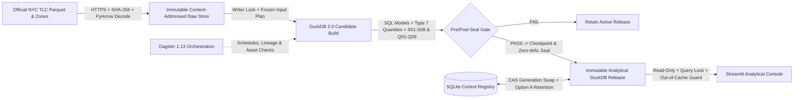
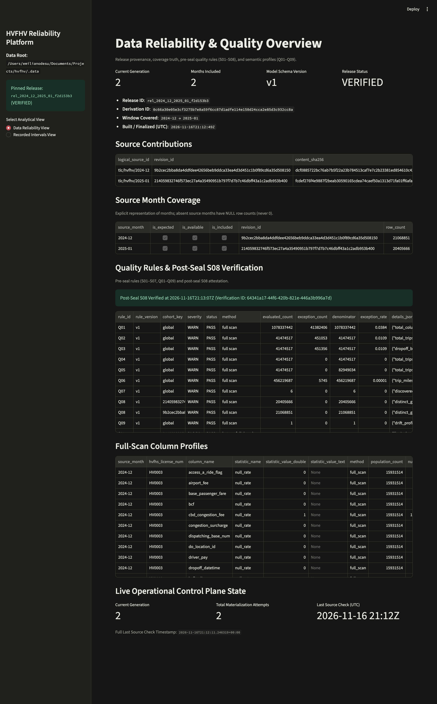
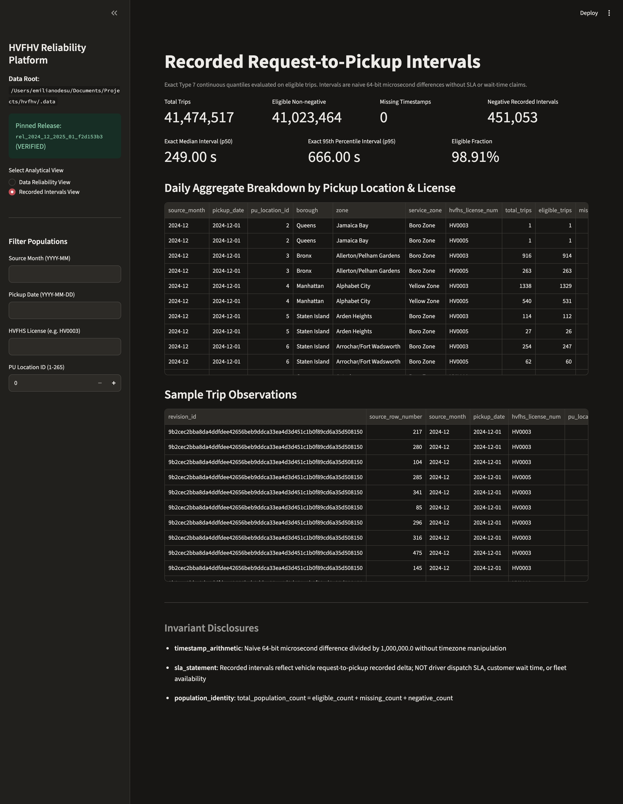
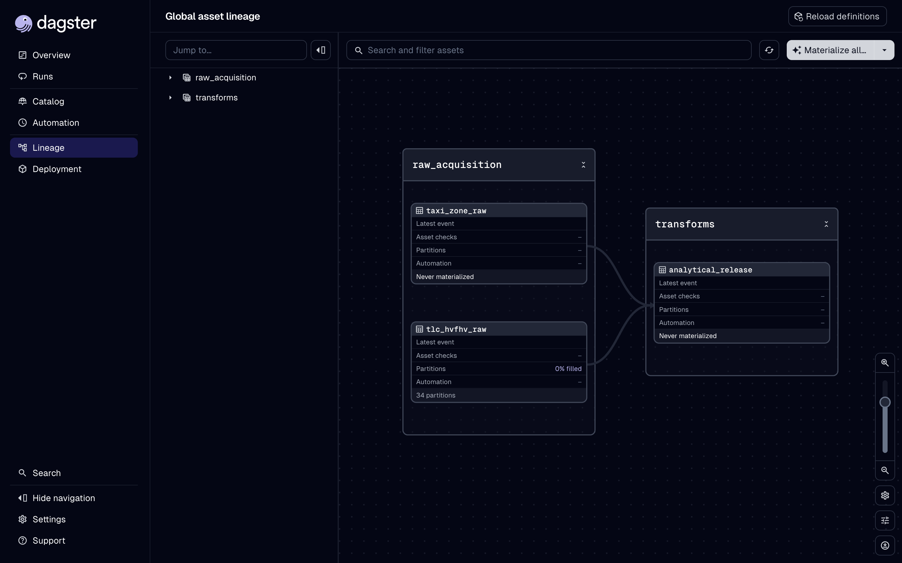

# HVFHV Monthly Data Reliability Platform


A production-grade, single-machine batch data platform for **official NYC TLC High-Volume For-Hire Vehicle (HVFHV)** trip datasets — combining immutable content-addressed Parquet acquisition, native DuckDB 2.0 transformations, strict SQLite compare-and-swap (CAS) publication control, Dagster orchestration, and a read-only Streamlit analytical console without cloud or distributed-cluster overhead.

Processed and audited end-to-end across **41,474,517 official trip records** (`2024-12` and `2025-01`), bridging the 2025 NYC Congestion Pricing **24-to-25 column schema transition** with zero silent coercion, `0` uncheckpointed WAL files, `0` spill files, and `229` passing automated gate and adversarial tests.

---

## Architecture



### Core Engineering Design

- **Atomic Publication & Recovery (`hvfhv.control`)**: SQLite (`DELETE` journal mode, `synchronous=EXTRA`, `foreign_keys=ON`) is the single publication authority. Releases are sealed cleanly (`CHECKPOINT`, zero WAL residual), hashed (`analytics.duckdb`, `manifest.json`, `validation.json`), and activated via compare-and-swap (`expected_parent`, `expected_generation`, idempotent `operation_key`). POSIX `fcntl.flock` serializes writers (`writer.lock`) and bounds concurrent readers (`query.lock`).
- **80 GiB Budget & Option A Retention ([ADR 0006](docs/architecture/decisions/0006-amend-release-retention-to-option-a.md))**: Measured 12-month projections showed that retaining 4 full-window DuckDB snapshots (`current` + `2` prior + `1` staging candidate) would reach `~98.13 GiB` and breach the `80.0 GiB` workstation cap. Under Option A, the retention engine protects `current` + `1` prior verified database (`~20.75 GiB` measured on 2 months; `~57–63 GiB` at 12 months) and performs audited retirement of older `.duckdb` binaries while preserving cryptographic manifests and raw Parquet files for deterministic rebuilds.
- **Cross-Year Schema Evolution (`24 → 25` Columns)**: `hvfhv_24col_pre2025.v1` (`2024-12`) lacks `cbd_congestion_fee`, whereas `hvfhv_25col_2025onward.v1` (`2025-01+`) introduces it. The transform layer tracks `cbd_fee_field_present` explicitly so pre-2025 `NULL` values are never silently coerced to `$0.00`.
- **Exact Analytics & Semantic Honesty**:
  - **Interval Identity**: $\text{total} = \text{eligible\_nonnegative} + \text{negative\_recorded\_interval} + \text{missing\_timestamp}$ holds across all views.
  - **Exact Type 7 Quantiles**: `p50` and `p95` are evaluated via DuckDB `quantile_cont` directly on eligible observations (`64-bit` microsecond integer delta), never averaged across daily or zonal subgroups.
  - **Out-of-Cache Consumer Guard**: Streamlit's bounded LRU cache (`32` entries / `5 MiB` cap) verifies release eligibility against SQLite **before and after** every read so a `REJECTED` or `RETIRED` release is blocked immediately.

---

## Verified Real-Data Benchmarks (41.47M Official Trips)

Measured against official NYC TLC releases (`fhvhv_tripdata_2024-12.parquet`, `fhvhv_tripdata_2025-01.parquet`, and `taxi_zone_lookup.csv`) on local SSD hardware:

| Metric / Stage | Release 1 (`2024-12` Single Month) | Release 2 (`2024-12` + `2025-01` Window) |
| :--- | :---: | :---: |
| **Total Trips Ingested** | `21,068,851` | `41,474,517` |
| **Interval Partition** | `20,817,586` eligible / `251,265` negative / `0` missing | `41,023,464` eligible / `451,053` negative / `0` missing |
| **Eligible Wait Quantiles (Type 7)** | `p50 = 268.0s` / `p95 = 716.0s` | `p50 = 249.0s` / `p95 = 666.0s` |
| **Build Wall Time** | `20.61s` | `32.63s` (incremental) |
| **Peak Process RSS** (`<= 8,192 MB` cap) | `6,227.20 MB` | `7,634.23 MB` |
| **Released DuckDB Size** | `992.76 MiB` (`0` WAL, `0` spill) | `1,957.76 MiB` (`0` WAL, `0` spill) |
| **Total Footprint (`<= 80 GiB` cap)** | — | `20.75 GiB` (`59.25 GiB` headroom, Option A) |
| **Read-Only Consumer Query Time** | — | `1.923s` (cold headless `ReleaseReader`) |
| **Dagster Asset Checks & Frontier** | `17 / 17` PASS | `17 / 17` PASS (`SYNCHRONIZED`) |

> **CBD Fee Transition Observed (`S02` / `Q06`)**: Across `20,405,666` trips in `2025-01`, `14,105,454` recorded `$0.00` and `6,300,212` recorded positive Congestion Relief fees up to `$3.00` (`p95 = $1.50`), while all `21,068,851` rows in `2024-12` retain explicit `NULL` (`cbd_fee_field_present = false`).

---

## UI & Lineage Preview

### Streamlit — Data Reliability & Quality Overview


### Streamlit — Recorded Request-to-Pickup Intervals (41.47M Official Trips)


### Dagster — Global Asset Lineage


---

## Tech Stack

- **Analytical Compute**: DuckDB `2.0.0`, PyArrow `26.0.1`
- **Control Plane & Locking**: SQLite `3.50+` (`DELETE` journal, `synchronous=EXTRA`, FK enforcement), POSIX `fcntl.flock`
- **Orchestration & Lineage**: Dagster `1.13.30`, `dagster-webserver` `1.13.30`
- **Acquisition & Telemetry**: `httpx` `0.28.1` (TLS + bounded retries + SSRF allowlist), `psutil` `7.2.2`
- **Presentation**: Streamlit `1.67.0`
- **Verification**: `pytest` `9.2.0` (`229` gate & adversarial stress tests)

---

## Repository Layout

```text
├── .github/workflows/ci.yml   # Automated CI workflow running the full pytest suite
├── contracts/                 # JSON schema contracts & validation rules (S01-S08, Q01-Q09)
├── sql/                       # DuckDB analytical models & continuous quantile profiles
├── src/hvfhv/
│   ├── acquisition/           # HTTPS acquisition, SHA-256 verification, PyArrow decode, frontier scan
│   ├── consumer/              # Read-only DuckDB reader, LRU guard & Streamlit dashboard
│   ├── contracts/             # RFC 8785 canonical JSON & deterministic derivation hashing
│   ├── control/               # SQLite registry, POSIX locks, CAS publication & Option A retention
│   ├── orchestration/         # Dagster assets, schedules, gap-aware sensors & asset checks
│   └── transforms/            # DuckDB ingestion, 24->25 col adaptation, quality engine & builder
├── scripts/
│   └── run_real_tlc_pipeline.py  # End-to-end acquisition & publication runner for official NYC TLC files
├── tests/                     # 229 automated tests across Gates G0-G5 (unit, recovery, adversarial)
├── docs/                      # Architecture (arc42/ADRs), data contracts, execution logs & UI assets
├── references/                # Preserved schema inspection profiles from NYC TLC source evaluation
├── pyproject.toml             # Package metadata & pytest configuration
└── requirements.lock          # Pinned dependency lockfile
```

---

## Quickstart

### 1. Create Environment & Install Locked Dependencies

Requires Python `3.11`–`3.14`:

```bash
python3 -m venv .venv
source .venv/bin/activate
pip install -r requirements.lock
pip install --no-deps -e .
```

### 2. Run the Full Automated Verification Suite

```bash
pytest -q
```

Expected result: all **`229` tests pass** (`0` skipped, `0` failed) across Gates `G0`–`G5`, covering environment pragmas, network fault injection, schema tampering, DuckDB `CHECKPOINT` invariants, POSIX lock contention, CAS conflict storms, crash-state reconciliation, and Streamlit UI rendering.

*(Runtime state defaults to `<repo>/.data` and can be relocated via `export HVFHV_DATA_ROOT=/path/to/data`.)*

### 3. Execute the Real NYC TLC Pipeline

Download official monthly Parquet files (`taxi_zone_lookup.csv`, `2024-12`, `2025-01`), build verified DuckDB releases, and publish atomically via SQLite CAS:

```bash
PYTHONPATH=src:. python scripts/run_real_tlc_pipeline.py
```

*(Note: downloads ~`1.0 GB` of official NYC TLC data into `.data/raw/sha256/`.)*

### 4. Launch Local UIs (Loopback)

**Streamlit Read-Only Analytical Console (`http://127.0.0.1:8501`)**:

```bash
PYTHONPATH=src:. streamlit run src/hvfhv/consumer/app.py \
  --server.address 127.0.0.1 --server.port 8501 \
  --server.headless true --browser.gatherUsageStats false
```

**Dagster Asset Lineage & Checks UI (`http://127.0.0.1:3000`)**:

```bash
PYTHONPATH=src:. DAGSTER_HOME="$PWD/.data/orchestrator" \
  dagster dev -f src/hvfhv/orchestration/defs.py -h 127.0.0.1 -p 3000
```

---

## Verification & Documentation Index

| Gate / Document | Focus | Link |
| :--- | :--- | :--- |
| **G0–G6 Verification Matrix** | Acceptance scenarios (`T01`–`T29`) and evidence tiers | [Acceptance Plan](docs/verification/acceptance-plan.md) |
| **Empirical Execution Log** | Real TLC SHA-256 digests, telemetry, and test logs | [Execution Log](docs/verification/execution-log.md) |
| **Architecture & ADRs** | System boundaries, SQLite schema, ADRs `0001`–`0006` | [Architecture Overview](docs/architecture/overview.md) |
| **Data & Quality Contracts** | Rule inventory (`S01`–`S08`, `Q01`–`Q09`) & interval definitions | [Data Contracts](docs/reference/data-contracts.md) |
| **Resource Checkpoint** | 12-month storage capacity analysis & Option A rationale | [Gate 2 Report](docs/verification/gate2_pause_report.md) |

---

## Domain Scope & Limitations

- **Recorded Request-to-Pickup Interval != Customer Wait Time**: NYC TLC trip records reflect provider-reported naive timestamps (`request_datetime` to `pickup_datetime`); timezone localization and unrecorded app-dispatch behavior remain external to the source files. Both UI views and SQL outputs surface this boundary explicitly.
- **Process Crash vs. Power Loss**: File-locking (`fcntl.flock`), SQLite rollback (`synchronous=EXTRA`), and release publication tests validate process kills (`SIGKILL`) and partial-write recovery; raw hardware power-loss guarantees remain explicitly outside workstation scope.

---

## License

Source code and documentation in this repository are licensed under the [MIT License](LICENSE). Official NYC TLC trip datasets acquired at runtime remain subject to [NYC Open Data](https://opendata.cityofnewyork.us/) and NYC Taxi & Limousine Commission terms of use and are excluded from version control.
