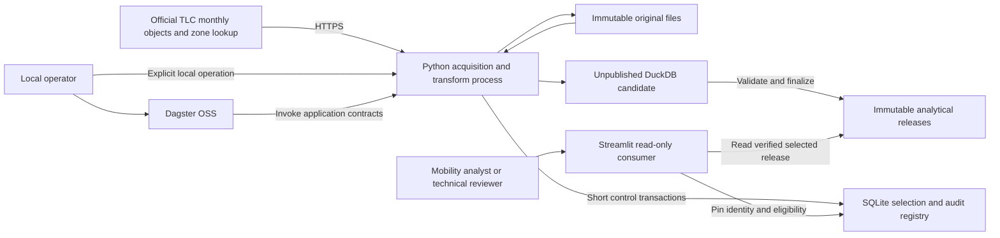
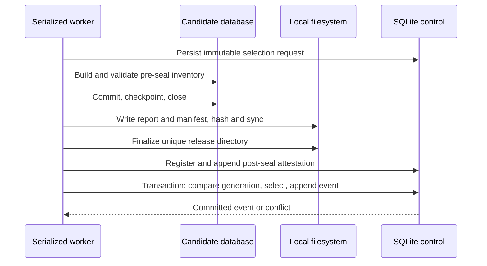
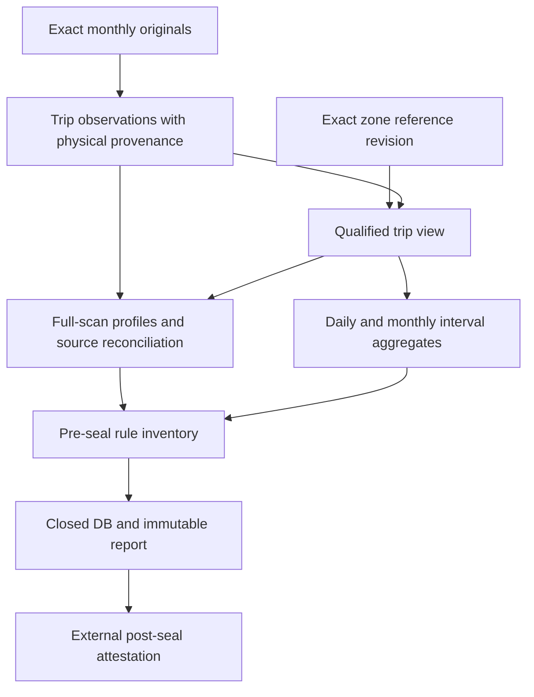

# Architecture views

Design notation inspired by C4; Mermaid diagrams are simplified views, not a formal C4 conformance claim. “Process” below means a local program, not a Docker container. Text contracts are authoritative.

## Context and runtime responsibilities

The control registry is the single current-release authority. Dagster metadata is scheduling/run history; it is not a second selection pointer. All processes run locally; external traffic is source acquisition. Services are intended for loopback, with no public deployment in v1.

## Publication sequence

The filesystem and SQLite are not one transaction. A finalized unselected release remains an orphan until explicit verified reconciliation. Loss of acknowledgement is resolved through the original operation key; no blind repeat.

## Model dependencies

Source revision changes replace their contribution. Reference/rule/metric changes invalidate documented dependents. Recomputing aggregate relations after incremental ingestion is intentional. No computed percentile is merged from subgroup percentiles.

These diagrams summarize runtime responsibilities, publication sequence, and model lineage; consult the operations design for full failure-recovery paths.
