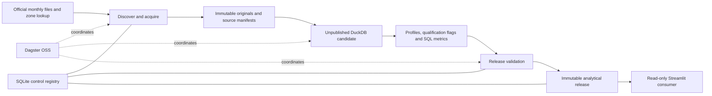

# HVFHV Monthly Data Reliability Platform — Architecture v1

Architecture overview grounded in [source assessment](../evidence/source-research.md). Primary objective: build a reliable, reproducible single-machine monthly analytical pipeline with semantic quality gates, profiling, and crash-safe recovery over official NYC TLC HVFHV trip datasets. Secondary output: recorded request-to-pickup interval analytics.

## 1. Selected architecture and stack

A single-machine batch system with immutable original Parquet files, a transactional control registry, an unpublished analytical candidate, and immutable published DuckDB releases. A release contains the trip model, quality profiles, exclusions and consumer metrics together. Orchestration coordinates the work; it is not the authority for which data is currently published.

| Responsibility | Selected technology / policy |
| --- | --- |
| Acquisition, manifests, coordination | Python; HTTPS downloads from official TLC publication links |
| Original evidence | Exact Parquet bytes on local filesystem; SHA-256; source/HTTP metadata |
| Transformation and profiling | DuckDB embedded, version-controlled SQL; PyArrow for Parquet inspection |
| Application control registry | SQLite; source revisions, attempts, releases, transactional current-release selection |
| Orchestration | Dagster OSS with durable local instance metadata; local execution, one materializing run at a time |
| Quality | Versioned SQL checks and Python structural checks; Dagster displays results but does not own duplicate rule implementations |
| Analytical storage | Immutable released DuckDB database files; each contains a consistent analytical release |
| Consumer | Local Streamlit read-only dashboard, with release-specific caching and read-only connections |
| Verification | pytest, SQL assertions, integration/failure-recovery scenarios and measured resource checks |
| Packaging | Dedicated locked Python environment; direct local processes for v1; no Docker dependency |

Exact package pins and Python minor version are low-level compatibility work, not selected from untested latest-version combinations. The implementation must produce a verified lockfile before accepting any dependency combination. If a needed operation is unsupported, record an explicit amendment; do not silently change architecture.

Not included in v1: Spark, Iceberg, Delta, Kafka, object-store servers, cloud infrastructure, Kubernetes, dbt, Great Expectations, a separate API, feature store or ML model. This is a native analytical database architecture, not a claimed lakehouse or Data Mesh. SQL remains modular and documented without dbt. A separate architecture amendment can adopt an open table format if snapshot interoperability, concurrent writers or measured storage/copy costs justify it.

## 2. Scope and data boundaries

- Primary source: original monthly TLC HVFHV Parquet, plus the official taxi-zone lookup. Yellow is excluded from v1 rather than combined through misleading common column names.
- Initial analytical horizon: the latest 12 published months, configured explicitly at bootstrap. At current observed availability that would be October 2025 through September 2026; discovery must verify actual availability when implementation begins. This is a scope decision, not a completed backfill.
- The release's analytical window advances with new source months. Original evidence is not deleted merely because it falls outside that window. Older replay is an explicit run configuration, not a requirement to load the full historical archive.
- December 2024 and January 2025 serve as real schema-change reference cases outside that initial window. They are not silently mixed into the consumer's rolling-year metrics.
- No synthetic rides are used as the project's business source. Small synthetic fixtures are appropriate later for isolated failure cases; they must remain labeled and separate.
- Source access is public and observed without API keys. Original evidence stays local. Future public code/demo publication requires review; no bulk data mirroring is assumed.

## 3. Responsibility flow

These are responsibilities, not mandatory Bronze/Silver/Gold copies. Original Parquet is preserved; analytical transformations reside in the candidate/released database. Profiles are first-class outputs, not only log messages.

## 4. Identity, change and execution units

Source identity has two parts: logical monthly object and exact observed content revision. URL, ETag and Last-Modified aid discovery; SHA-256 of a completed download identifies content. ETag is not treated as a checksum or a guaranteed revision notification. Daily discovery while the environment is running checks new publications and metadata for the active window; operator-requested revalidation can redownload contents. No promise to discover every upstream change instantly or to recover historical revisions never observed.

Processing is scoped by source month and content revision, with rule/code/reference-data versions included in derivation identity. The source month is provenance, not an assertion that every pickup occurred in that month. Valid event-month differences remain traceable. The curated model does not silently discard rows because of the filename month.

There is no invented real-world trip primary key. A provenance row locator identifies a row within exact source content; it is not a stable ID across revised source files. Repeating the same accepted source contribution is idempotent. A changed source revision replaces that object's contribution in the candidate rather than appending the old and new versions together. Equal source rows are reported as possible duplicates, not removed without a defensible rule.

One materializing run and one embedded DuckDB writer process may operate at a time. Parallel historical writes to the same database are outside v1. Read-only consumers never connect to a candidate under construction. Direct CLI entry points must honor the same writer lock as orchestrated runs; Dagster configuration alone is insufficient enforcement.

## 5. Publication and recovery model

Published databases and their supporting files are immutable. A candidate is created separately, initially from originals or from a clean copy of a prior released database. Only affected source contributions and dependent results are recomputed where semantics allow; a complete rebuild remains the correctness reference, not the default monthly action.

The publication boundary is the release, not an individual model or successful task. Trips, profiles, rule outcomes, reference-data version and metrics must agree on release identity. The candidate is checked, checkpointed and closed so it has no uncommitted/WAL dependency. Its exact files are hashed and placed in a finalized release directory on the same local filesystem. Only then does a SQLite transaction select the release as current and record its publication state. A reader resolves current once and pins that immutable release for a query/session; it cannot mix versions mid-query.

This uses standard database/file primitives for an application release; it does not create a general table format or distributed transaction protocol. Directory finalization and SQLite selection are separate steps with an explicit safe gap: finalized but unselected output is an orphan candidate, never automatically current. Synchronization/durability details must be verified on supported filesystems before claiming crash guarantees. No network filesystem is supported in v1.

Recovery cases to demonstrate later:

| Interruption | Required behavior |
| --- | --- |
| During acquisition | Partial file cannot become accepted evidence; resume/retry must validate source identity |
| During transformation | Existing published release stays usable; partial candidate remains unpublished |
| After finalization but before current selection | Reconcile the orphan directory against registry and manifest; do not expose it automatically |
| After publication with lost acknowledgement | Read registry/current release and verify identity before repeating the operation |
| Quality publication gate fails | Keep last known valid release; surface failure and stale-current status |
| Published release is later rejected | Explicit rollback selects a retained verified release; never edits its contents |

SQLite control data is the application publication authority. Dagster metadata owns run scheduling/logs. Profiles and analytical facts belong to the release. This separates responsibilities rather than maintaining competing current-data pointers.

## 6. Profiling, quality and semantic policy

Three classes of findings:

1. Structural failures: unreadable/truncated input, unsupported required schema, incomplete transformation, inconsistent release references. These block the release.
2. Semantic exceptions: missing/negative intervals, questionable durations, unknown locations or amounts. Preserve originals and record typed flags; eligibility is metric-specific. Exceptions are not silently repaired by absolute value, clipping or zero filling.
3. Distribution/coverage changes: new codes, changed null rates, shifts by month/license/zone. Report comparisons and denominators. Numeric anomaly thresholds require measured baseline evidence; no arbitrary pass-rate target is adopted.

Hard gate logic lives in the publish-validation operation and must fail closed. Dagster checks surface the same results; correctness does not depend on its default check blocking behavior or preview-only check features.

Profile rows, schema/types, nulls, categorical cardinality, reference coverage, ranges/quantiles and temporal relationships. Separate provider/license cohorts where useful; profile aggregate rates alone can hide compositional changes. In production runs the intended scope of each metric (full scan, footer statistic, approximation or sample) must be machine-readable and visible. Research samples do not establish thresholds.

Preserve timestamp values and their source representation. The derived field is named `recorded_request_to_pickup_seconds`, based on stored values, with explicit timezone/DST uncertainty. Negative/missing intervals are excluded from nonnegative interval summaries but remain visible as counts and flags. This is an arithmetic eligibility policy, not a claim that excluded records are globally invalid. Other questionable positive values are profiled; no arbitrary maximum waiting-time filter is selected.

Do not present on_scene as a universal arrival measure until its observed coverage change is explained. Do not force trip_time to equal timestamp subtraction without a documented tolerance and rationale. No UTC conversion or business explanation is manufactured. Exact quantiles are the default for the selected eligible population; a switch to approximate quantiles requires accuracy characterization and an explicit label. Monthly p95 is not an average of daily p95 values.

## 7. Consumer and model boundary

One trip observation model with provenance and qualification flags, a versioned zone reference, and dedicated profile/check/aggregate relations. No fabricated driver/customer dimensions, SCD history inferred from a current lookup, or transactional payment model.

The Streamlit consumer has two equally important views:

- Data reliability: published release/version, source periods, last source check, source lag versus processing lag, coverage, rule outcomes and exceptions.
- Recorded intervals: eligible counts, median/p95 interval and trip activity by zone/time/license, with denominators and exclusions. It does not claim rejected-request demand, fleet availability, dispatch SLA or causal policy impact.

Serving uses immutable read-only releases. Connections/caches are scoped safely and keyed by release identity; a global shared mutable connection is not assumed safe. The consumer can keep a prior release open while a new one is prepared. An absent source month is not displayed as zero trips. This local consumer closes the end-to-end path; permanent public hosting is not required for v1.

## 8. Operation, retention and resource limits

Local Dagster schedules source checks daily only while its environment is running. Discovery/backfill reconcile missed periods on resumption. No always-on availability or source publication deadline is promised. A local-only scheduler cannot execute while the workstation is off. On-demand CLI/orchestrator execution must remain supported for reviewers.

Initial engineering budgets, to be validated rather than advertised as achieved: one active materializing run; four DuckDB threads; 8 GiB engine memory target; 16 GiB temporary spill cap; 80 GiB total project-data budget, with temporary space included. The engine memory setting is not a strict whole-process RSS cap, so external measurements are required. Stop before publication on resource exhaustion; do not reduce input or skip checks silently. There is no unmeasured runtime SLA.

Keep current and two previous successful releases available for rollback. Raw source revisions and published evidence are retained until explicit cleanup. Older releases beyond the rollback set and failed candidates become cleanup-eligible, not automatically deleted in v1. The budget may therefore stop growth and require reviewed cleanup. No current/open-reader artifact can be removed. Future retention automation would require a separate decision and verification.

No cloud, paid service, object-store emulator or container daemon is needed for v1. Locked dependencies and documented commands provide the initial reproducibility mechanism. Packaging in containers can be considered separately after working behavior is verified; it is not evidence of robustness by itself.

## 9. Acceptance boundaries and architecture amendments

Acceptance guarantees verified across `G0`–`G6`: source revision traceability; no repeated-load inflation; safe failure/retry; consistent release publication/rollback; detection of observed schema changes; explicit temporal qualification; profiles with correct coverage; and a read-only consumer pinned to a verified release. See [ADR 0006](decisions/0006-amend-release-retention-to-option-a.md) for the Option A storage retention amendment.

A stack amendment is warranted if measured backfills/queries exceed agreed resources, concurrent writers/readers require a different deployment, native release-copy retention is impractical, or open-table interoperability/distributed execution becomes an explicit learning objective. Iceberg/Delta and Spark are then evaluated against that concrete trigger rather than added by default.

Remaining low-level work: dependency pins, concrete interfaces/schema, filesystem durability protocol, detailed check specifications, validation fixtures and execution sequence. These refine the chosen architecture. Source semantic uncertainties are retained as visible limitations; resolving them can revise metric definitions without pretending architecture alone solved them.

## Sources supporting technology boundaries

Read on 2026-11-09. Full source evidence and alternatives are in the linked research report.

- [DuckDB concurrency](https://duckdb.org/docs/2.0/connect/concurrency): embedded writer and read-only boundaries.
- [DuckDB workload limits](https://duckdb.org/docs/2.0/guides/performance/how_to_tune_workloads): out-of-core processing does not guarantee bounded whole-process memory for all queries.
- [Dagster checks](https://dagster.io/docs/guides/test/asset-checks): display/check behavior is distinct from a guaranteed application publication gate.
- [Dagster deployment](https://dagster.io/docs/deployment/oss/deployment-options/docker): multi-service Docker deployment exists but is not required by this selected local v1.
- [Streamlit resource caching](https://docs.streamlit.io/develop/api-reference/caching-and-state/st.cache_resource): global resources require thread safety; serving design must account for sessions and release identity.
